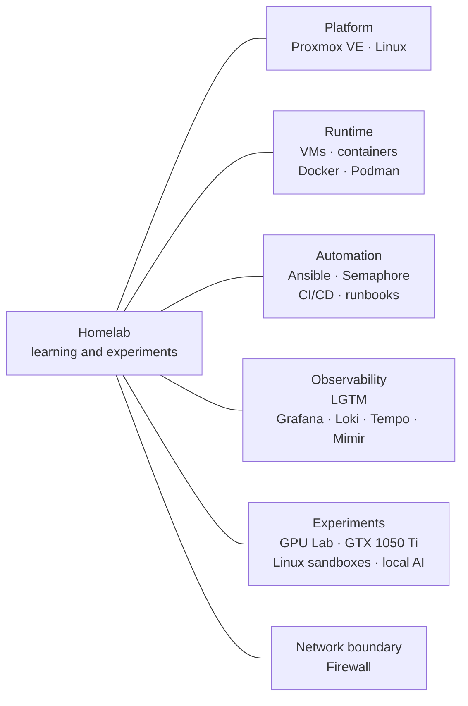

# Homelab

A personal environment for learning and experimenting with Linux, virtualization, containers, automation, observability, and local AI.

## Stack at a glance

The lab brings together Proxmox VE, Linux workloads, VMs and containers, Docker/Podman, Ansible/Semaphore, and an LGTM observability stack (Grafana, Loki, Tempo, Mimir). Experiments include a GPU Lab with a GTX 1050 Ti and Linux sandboxes. Runbooks, CI/CD, and a firewall support day-to-day learning and operation.

The branches group technologies by area; they do not describe traffic, host placement, configuration, or live status. This repository is a high-level introduction and learning record, not an operational guide or deployment blueprint.

## Documentation

- [Infrastructure](docs/infrastructure.md)
- [Services](docs/services.md)
- [Automation and operations](docs/automation.md)
- [GPU Lab](docs/experiments/gpu-lab.md)
- [Project notes](docs/projects/)

Original writing and diagrams are [CC BY 4.0](CONTENT-LICENSE.md).
