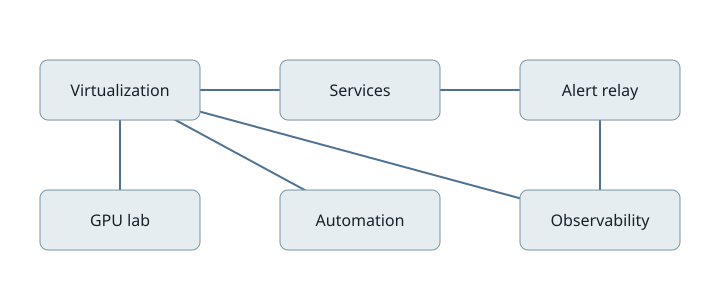
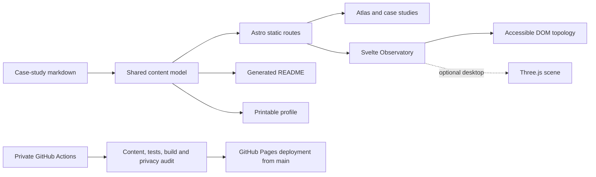

<div align="center">

<h1>Homelab portfolio</h1>

<p>    </p>

<p><strong>Infrastructure, understood by building.</strong></p>

<p>Infrastructure projects documented through hands-on work with Linux, virtualization, container operations, observability and shared GPU computing. Each case records a problem, a technical decision and the evidence available.</p>

<p><a href="#case-studies">Case studies</a> · <a href="#development-themes">Development themes</a> · <a href="#the-observatory">The Observatory</a> · <a href="#professional-summary">Professional summary</a> · <a href="#run-locally">Run locally</a> · <a href="#contact">Contact</a></p>

</div>

## Skills

Linux · Proxmox · Podman · systemd · Ansible · Semaphore · Grafana · Loki · Python

## Case studies

Each study records its context, decision, observed result, learning and documented state. Results remain tied to the evidence and date of their source.

| Study | Focus | Technologies |
|---|---|---|
| [Automation with a review boundary](content/cases/automation.md) | Ansible and Semaphore separate read-only discovery, simulation and guarded changes. | Ansible, Semaphore, Proxmox, Linux |
| [Decoupling an RSS relay from inference](content/cases/rss-relay.md) | Removing an unnecessary GPU dependency while retaining reliable feed delivery. | Python, Miniflux, Discord, HMAC |
| [Making telemetry failures visible](content/cases/observability.md) | Freshness and delivery status matter as much as collected metrics. | Python, systemd, Uptime Kuma, Grafana, Loki |
| [Safer alert delivery](content/cases/alert-relay.md) | A local relay keeps alert credentials out of a plugin's error messages. | CrowdSec, Telegram, Python, systemd |
| [Sharing a GPU safely](content/cases/gpu-lab.md) | A single lifecycle controller coordinates an interactive lab and production inference. | Linux, systemd, Podman, GPU, Python |

## Development themes

Each phase pairs a challenge with a lesson. They group related work as editorial themes, not a measured chronology.

| Theme | Challenge and learning | Related studies |
|---|---|---|
| Foundation | Keep management and workload boundaries clear.<br>Treat documented configuration and live state as distinct. | Automation with a review boundary |
| Services | Keep service delivery independent of scarce compute.<br>Remove unnecessary dependencies from a critical path. | Decoupling an RSS relay from inference |
| Automation & observability | Distinguish missing, old and failed observations.<br>Keep safe inspection separate from changes. | Automation with a review boundary, Safer alert delivery, Making telemetry failures visible |
| Accelerated computing | Prevent stale sessions from claiming a shared resource.<br>Prove ownership and cleanup together. | Sharing a GPU safely |

## The Observatory



The Observatory connects a selected component to its documented projects, skills and phase. The accessible DOM topology is the source of truth; Three.js renders the same nodes and relationships as an optional desktop view.

On desktop, the 3D scene loads when the Observatory approaches the viewport. Narrow layouts and unavailable WebGL keep the DOM topology usable. Keyboard and touch controls, browser history, reduced-motion preferences and shareable URLs preserve access to the same information.

## Professional summary

The `/profile/` route presents a concise, project-based summary that readers can print.

## Site routes

| Route | Purpose |
|---|---|
| `/` | Atlas home, skills, project index, lessons and Observatory |
| `/cases/` | Catalogue of all five studies |
| `/cases/<id>/` | Full study with context, decisions and documented state |
| `/profile/` | Printable, project-based professional summary |
| Unknown path | Editorial 404 page |

## Architecture



The shared content model drives the site and this README. The Observatory keeps its DOM topology available when the optional Three.js view cannot run.

## Run locally

Requires Node.js 22.23.4 or newer.

```sh
npm ci
npm run dev
```

Open the local address printed by Astro, normally `http://localhost:4321`.

To inspect the static build, run these commands after stopping the development server:

```sh
npm run build
npm run preview -- --host 127.0.0.1 --port 4321
```

## Verify changes

Run the content, unit, dependency, build, public-content and browser checks:

```sh
npm run content:check
npm run content:build
npm test
npm audit --omit=dev --audit-level=moderate
npm run build
npm run audit:public
npm run test:e2e
```

Install Chromium once before the browser suite with `npx playwright install chromium`. Build before `npm run test:e2e`; Playwright serves the generated `dist/` site on `127.0.0.1:4327`.

Private GitHub Actions verifies pushes and pull requests. A push to `main` deploys only after verification; Pages and OIDC write permissions are isolated to that job. The Pages build uses `SITE_BASE_PATH=/homelab-portfolio` and sets `PUBLIC_SITE_URL` at deployment time.

`npm run audit:public` checks configured patterns in authored and generated files. It is a heuristic, not proof that every possible exposure has been removed.

## Privacy and publication

The source repository remains private. The workflow is configured to deploy the static site to GitHub Pages from `main`; its public URL will be listed here only after deployment succeeds and public browser access is validated. Case studies distinguish historical records from current live state, and the topology is illustrative rather than a physical inventory.

## Contact

[GitHub profile](https://github.com/AndersonTavares0)

## License

Original code is [MIT licensed](LICENSE). Original writing and diagrams are [CC BY 4.0](CONTENT-LICENSE.md). Third-party dependencies and fonts retain their own licenses.
