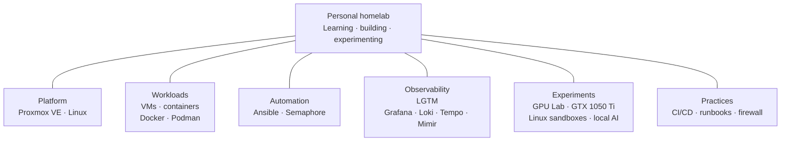

<h1>Homelab · Engineering notes</h1>

<strong>A personal engineering lab for learning by building, experimenting, and improving systems.</strong>

<a href="#technology-stack">Stack</a> · <a href="#how-the-lab-is-organized">Diagram</a> · <a href="#selected-engineering-work">Projects</a> · <a href="#documentation">Docs</a>

---

I am a **Software Engineering and Data Science student** interested in Linux, infrastructure, DevOps, automation, cloud, data, and AI. This homelab is where I connect that learning with practical systems work: choosing tools, exploring trade-offs, and documenting what each experiment teaches me.

It is a personal learning environment, not an enterprise platform. The portfolio focuses on the engineering behind the projects without publishing private configuration or operational access details.

The notes describe documented project work; they are not a live inventory or a claim of current service availability.

## Technology stack

| Area | Technologies | How I use the stack |
|---|---|---|
| Virtualization | Proxmox VE | The platform for virtualized systems and learning environments. |
| Systems | Linux | The main environment for infrastructure work, services, and experiments. |
| Containers | Docker, Podman | Building and operating containerized workloads. |
| Automation | Ansible, Semaphore | Making infrastructure work repeatable and easier to review. |
| Observability | LGTM: Grafana, Loki, Tempo, Mimir | Exploring metrics, logs, traces, and system behavior. |
| Compute | GPU Lab, GTX 1050 Ti | Experimenting with local inference, small language models, and shared compute. |
| Operations | CI/CD, runbooks, firewall, fallback | Learning how automation, visibility, and recovery support maintainable systems. |

## How the lab is organized

This is a **technology map**, not a deployment or network diagram. Each branch groups tools by area; it does not describe service traffic, host placement, configuration, or access procedures.

## Selected engineering work

### GPU Lab · local compute experiments

**Challenge:** explore small-model inference and interactive experiments on one consumer GPU.

**Engineering focus:** shared compute, container isolation, and predictable recovery, without presenting performance claims that were not measured.

**What it demonstrates:** Linux and container work, resource-aware design, and attention to failure cases.

**Technologies:** Linux · systemd · Podman · NVIDIA GTX 1050 Ti

[Read the GPU Lab notes](docs/experiments/gpu-lab.md)

### Infrastructure automation · repeatable operations

**Challenge:** make recurring infrastructure work easier to repeat without making changes difficult to understand.

**Engineering focus:** use Ansible and Semaphore to keep automation understandable, reviewable, and proportionate to a personal lab. Host inventories and access policy remain private.

**What it demonstrates:** infrastructure automation, change awareness, and clear limits around what the evidence proves.

**Technologies:** Ansible · Semaphore · Linux · Proxmox VE

[Read the automation notes](docs/automation.md)

### Observability · understanding system behavior

**Challenge:** distinguish useful telemetry from telemetry that is old, incomplete, or not delivered.

**Engineering focus:** use metrics, logs, traces, timestamps, and delivery feedback as separate signals across the LGTM stack.

**What it demonstrates:** observability fundamentals and the habit of stating what monitoring can—and cannot—prove.

**Technologies:** Grafana · Loki · Tempo · Mimir · Uptime Kuma

[Read the observability notes](docs/projects/observability.md)

### Service integrations · learning through iteration

Small alerting and feed-delivery projects explore reliability, separation of concerns, and the trade-offs of coupling routine work to local inference. Their notes explain the design lessons at a high level and label historical results as historical.

[Browse the project notes](docs/projects/)

## How I approach engineering

- Start with a concrete problem and explain why a tool belongs in the solution.
- Prefer changes that are understandable, reviewable, and proportionate to a homelab.
- Treat observability and recovery as part of a system, not an afterthought.
- Record evidence and limitations; do not turn a successful test into a claim of current availability.

## Learning focus

I am continuing to explore Linux, infrastructure, DevOps, cloud, networking, automation, data, and AI. The lab changes as those interests develop; this README highlights documented projects and current learning interests rather than a fixed specialization.

## Documentation

- [Infrastructure](docs/infrastructure.md) · [Services](docs/services.md)
- [Automation](docs/automation.md) · [Operations](docs/operations.md)
- [GPU Lab](docs/experiments/gpu-lab.md) · [All project notes](docs/projects/)

Original writing and diagrams are licensed under [CC BY 4.0](CONTENT-LICENSE.md).

**Anderson Tavares** · [GitHub profile](https://github.com/AndersonTavares0)

[GitHub profile](https://github.com/AndersonTavares0)
