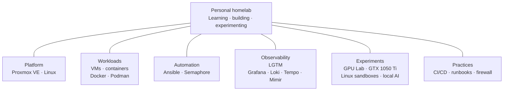

<h1>Homelab · Engineering notes</h1>

<strong>A personal lab for learning by building, experimenting, and improving systems.</strong>

<a href="#technology-stack">Stack</a> · <a href="#how-the-lab-is-organized">Diagram</a> · <a href="#selected-work">Projects</a> · <a href="#documentation">Docs</a>

---

This homelab is a hands-on environment for exploring **Linux, virtualization, containers, automation, observability, networking, and local AI**. The focus is the engineering practice: choosing tools, understanding trade-offs, and learning from experiments.

## Technology stack

| Area | Technologies | What I explore |
|---|---|---|
| Virtualization | Proxmox VE | Building and managing virtualized learning environments. |
| Systems and workloads | Linux, VMs, containers | Running a mix of general-purpose systems and isolated experiments. |
| Container tooling | Docker, Podman | Packaging and operating containerized workloads. |
| Automation | Ansible, Semaphore | Making recurring infrastructure work easier to review and repeat. |
| Observability | LGTM: Grafana, Loki, Tempo, Mimir | Exploring metrics, logs, traces, and ways to understand system behavior. |
| Compute experiments | GPU Lab, GTX 1050 Ti | Learning about local inference, small language models, and shared compute. |
| Operations | CI/CD, runbooks, firewall, fallback | Practicing maintainable operations and recovery at a homelab scale. |

## How the lab is organized

This is a **technology map**, not a deployment or network diagram. Each branch groups tools by area; it does not describe service traffic, host placement, configuration, or access procedures.

## Selected work

- **GPU Lab** — experiments with GPU sharing, resource management, and small local models.
- **Automation** — using Ansible and Semaphore to explore repeatable infrastructure work.
- **Observability** — learning from metrics, logs, traces, freshness, and system behavior.
- **Linux and containers** — building disposable environments for focused experiments.

These summaries stay at portfolio level. Private deployment details, access paths, and service-by-service procedures are not part of this README.

## Documentation

- [Infrastructure](docs/infrastructure.md) · [Services](docs/services.md)
- [Automation and operations](docs/automation.md) · [GPU Lab](docs/experiments/gpu-lab.md)
- [Project notes](docs/projects/)

Original writing and diagrams are licensed under [CC BY 4.0](CONTENT-LICENSE.md).
