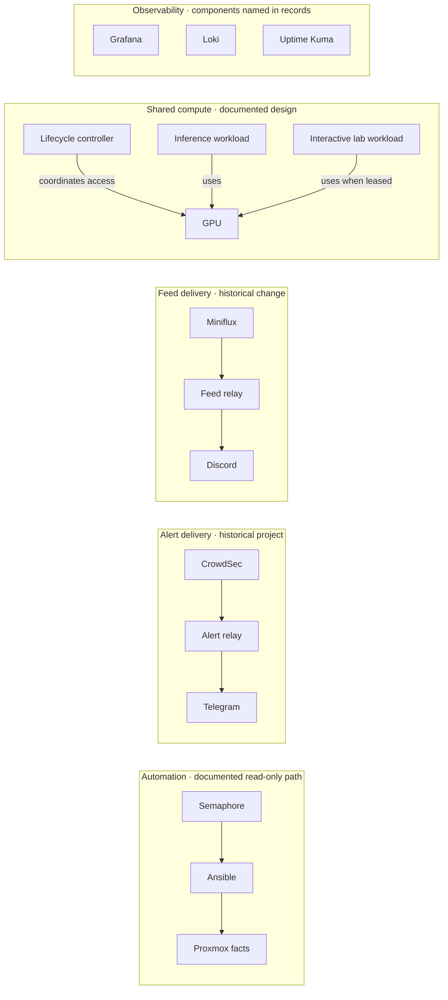

# Homelab notes

A public, project-based record of a personal homelab: the systems I explore, the decisions I make, and what I learn when something fails or changes.

This repository is documentation, not a deployment blueprint or live inventory. Project records describe specific historical work; they do not establish that a service is running today. Network addressing, host identifiers, access details, and raw configuration are intentionally omitted.

## Start here

- [Architecture](docs/architecture.md) — documented relationships between systems and projects.
- [Infrastructure](docs/infrastructure.md) — virtualization, operating systems, containers, and compute.
- [Services](docs/services.md) — the roles of services mentioned in the project records.
- [Automation](docs/automation.md) — how inspection and changes are separated.
- [Operations](docs/operations.md) — runbooks, recovery, CI/CD, and the public detail boundary.
- [GPU Lab](docs/experiments/gpu-lab.md) — sharing a GPU between inference and experiments.
- [Project records](docs/projects/) — decisions, evidence, limitations, and lessons from specific work.

## A map of documented work

The lines below describe relationships recorded in project notes. They do not show physical placement, network routes, or current health. The observability tools are listed without invented data-flow arrows.

The feed record documents a change that removed model inference from delivery; a later note records that model-backed processing returned. The diagram therefore identifies a documented project path, not the current implementation. For each project's evidence and limits, see its linked record below.

## Projects

- [GPU sharing](docs/experiments/gpu-lab.md) — resource ownership, lifecycle, and recovery boundaries.
- [Automation with a review boundary](docs/projects/automation.md) — separating inspection, simulation, and changes.
- [Alert delivery](docs/projects/alert-delivery.md) — reducing sensitive data in a notification path.
- [Observability](docs/projects/observability.md) — distinguishing fresh data from successful delivery.
- [RSS relay](docs/projects/rss-relay.md) — changing the dependency between feed delivery and inference.

## Scope and evidence

The records are based on retained project notes and owner-provided descriptions. They are not a fresh audit of the homelab. Where current placement, behavior, or health is not established, the documentation says so rather than inferring it. No storage or backup guide is included because the available evidence does not support one yet.

Original writing and diagrams are [CC BY 4.0](CONTENT-LICENSE.md).
