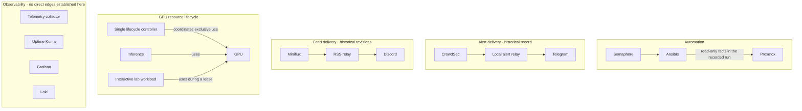

# Architecture

This is a map of documented project relationships, not a physical network diagram or current service inventory. It focuses on what each project connects and why. It omits addresses, machine names, management surfaces, and any path not supported by the retained notes.

## Reading the diagram

- **Automation:** a recorded workflow used Semaphore to launch Ansible; one validation collected facts from Proxmox without reporting changes. It does not establish the current workflow or a general network route.
- **Alerts:** a project record describes CrowdSec notifications passing through a small relay before reaching Telegram. The page describes the design and historical checks, not the current deployment.
- **Feeds:** the relay has changed over time. One recorded revision removed inference from the delivery path; a later note says model-backed processing was reintroduced. The current data flow is not established here.
- **GPU:** the project describes inference and an interactive lab sharing one GPU, with one controller arbitrating lifecycle. This is a resource relationship, not a network connection. The device model is recorded as GTX 1050 Ti in owner-provided notes; current assignment and inference health are not verified.
- **Observability:** Grafana, Loki, Uptime Kuma, and a telemetry collector appear in the records. No edge is drawn where direct data flow could not be established.

The diagram intentionally avoids physical layout and network segmentation. Those details add exposure without being necessary to explain the engineering decisions documented here.
