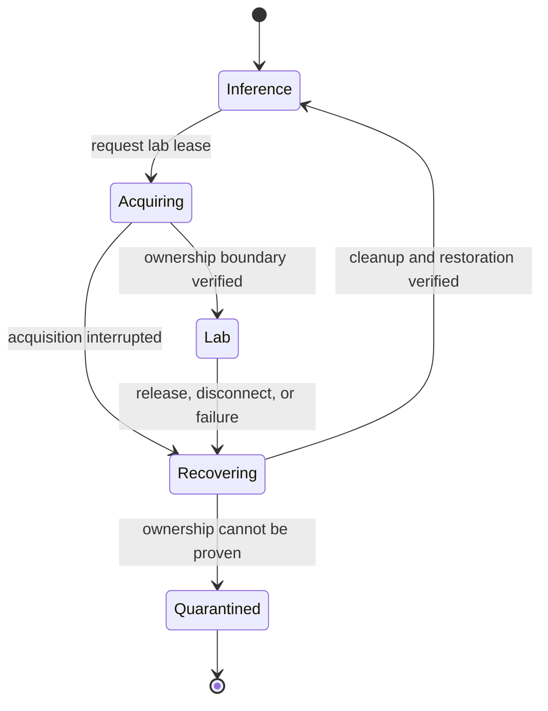

# GPU Lab

The GPU Lab explores how to share one consumer GPU between inference and interactive experiments without allowing a stale session to disrupt another workload.

The project notes identify a GTX 1050 Ti and describe production inference alongside an interactive Linux/Podman workload. The architecture uses one lifecycle controller to coordinate exclusive access. This page describes the design recorded in the project notes; it is not a claim about current device assignment or live service health.

## Lifecycle

The controller is the single authority for transitions. A stale operation must not release a newer session. When ownership cannot be established, the design records a closed/quarantined state instead of guessing that the resource is safe to reuse.

## Isolation and recovery

The historical implementation used a transient systemd service and a rootless Podman workload. A session was considered acquired only after its containment boundary was checked. Cleanup was designed to be repeatable and to verify that the workload had stopped before restoring inference.

The project record includes historical checks for interrupted acquisition, disconnect, stale release, and reacquisition. The normal remote job path was not validated in that record. These checks show what was exercised at that point; they do not establish current behavior, performance, or uptime.

## What I learned

Resource sharing is primarily an ownership and recovery problem. Proving the boundary during acquisition is not enough; cleanup must also prove that the old workload is gone before the next one proceeds. Unknown state should remain unavailable until it can be resolved safely.

For the concise project record and its evidence boundary, see [Sharing a GPU safely](../projects/gpu-lab.md).
